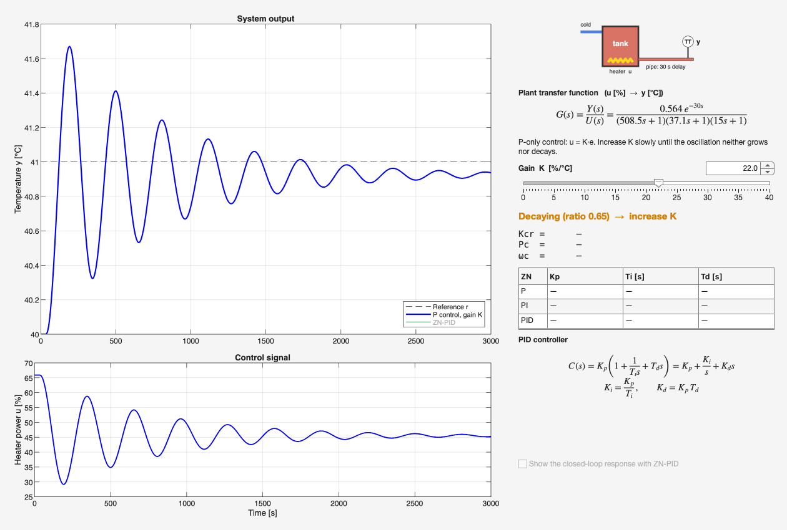
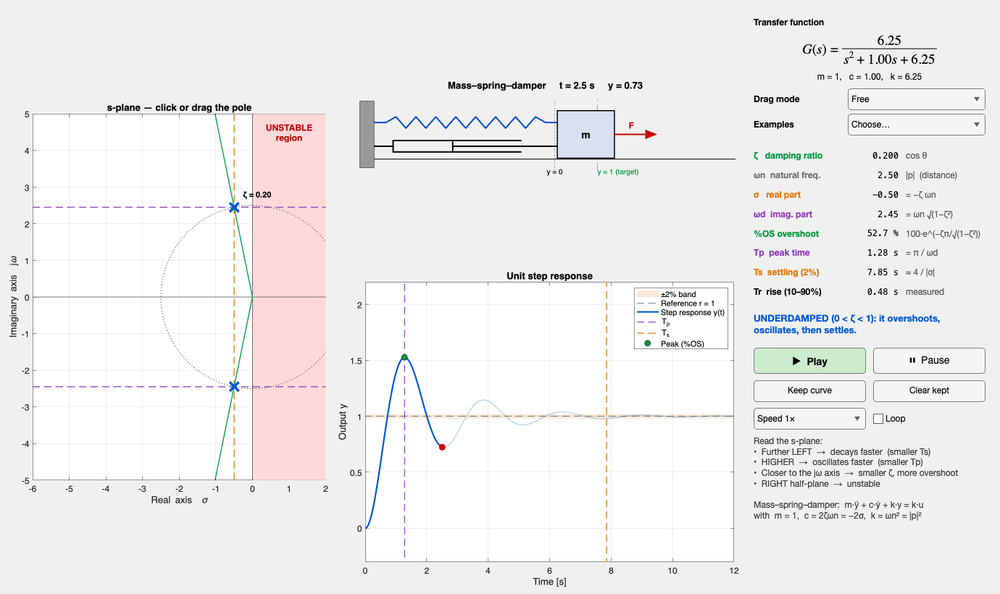

# KON314 – Ziegler–Nichols Tuning Lab

An interactive MATLAB app for teaching the **Ziegler–Nichols closed-loop (critical gain) method** on a real-world process: an electrically heated water tank whose temperature sensor sits at the end of an outlet pipe (≈ 30 s transport delay).

Students increase the proportional gain **K** step by step until the temperature oscillates with constant amplitude. The app then reports the critical gain **Kcr**, the period **Pc** and **ωc = 2π/Pc**, and gives the P / PI / PID gains from the Ziegler–Nichols table.



## Run it

```matlab
ZieglerNicholsLab
```

Requires MATLAB R2024b or newer. No toolboxes needed.

## What students see

- A sketch of the process and its transfer function

  $$G(s)=\frac{Y(s)}{U(s)}=\frac{0.564\,e^{-30s}}{(508.5s+1)(37.1s+1)(15s+1)}$$

- Live plots of the output y(t) and the control signal u(t)
- A status message: *decaying → increase K*, *growing → decrease K*, *sustained → K = Kcr*
- Kcr, Pc, ωc and the Ziegler–Nichols table
- The PID controller in both forms, $C(s)=K_p\left(1+\frac{1}{T_i s}+T_d s\right)=K_p+\frac{K_i}{s}+K_d s$, with $K_i = K_p/T_i$ and $K_d = K_p T_d$
- The closed-loop response with the ZN-PID

## Files

| File | Description |
|---|---|
| `ZieglerNicholsLab.m` | The app (a single MATLAB file) |
| `ZieglerNicholsLab_Guide.pdf` | Student guide (2 pages) |
| `ZieglerNicholsLab_Guide.md` | Student guide (Markdown) |
| `PoleDragLab.m` | Pole Drag Lab: drag the poles of a 2nd-order system (single MATLAB file) |

## Pole Drag Lab — where the poles are decides how it moves

`PoleDragLab.m` shows the link between the pole locations of a 2nd-order system and its step response.

$$G(s)=\frac{\omega_n^2}{s^2+2\zeta\omega_n s+\omega_n^2},\qquad p=\sigma\pm j\omega_d$$

```matlab
PoleDragLab
```



- Click or drag in the s-plane to move the pole pair. The mass goes back to rest and the expected response is shown faintly.
- **▶ Play** starts the mass–spring–damper ($m=1$, $c=2\zeta\omega_n$, $k=\omega_n^2$) from rest ($y=0$) and draws the step response as time runs. Use **Pause/Resume**, a speed of 0.25×–2×, and **Loop** to repeat.
- ζ, ωn, σ, ωd and the measured %OS, Tp, Ts and Tr update as the pole moves. The guide lines share colours with the readouts: vertical line ↔ Ts, horizontal line ↔ Tp, ray ↔ %OS (ζ), circle ↔ ωn.
- **Drag mode** keeps σ, ωd, ζ or ωn fixed while you drag, so students can see one specification stay fixed while the others change.
- **Examples:** ζ = 0.2, 0.7, 1, 0, and an unstable pole (the damper turns red: $c<0$).
- **Keep curve** freezes the current response in grey for comparison.

## Acknowledgement

Developed with the assistance of [Claude Code](https://claude.com/claude-code) (Anthropic).

## Acknowledgement

Developed with the assistance of [Claude Code](https://claude.com/claude-code) (Anthropic).

---
KON314 Control System Design
