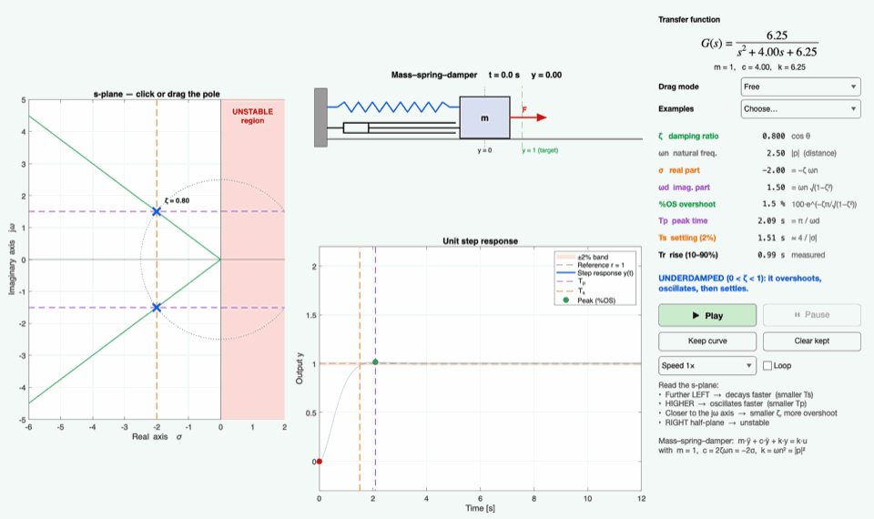
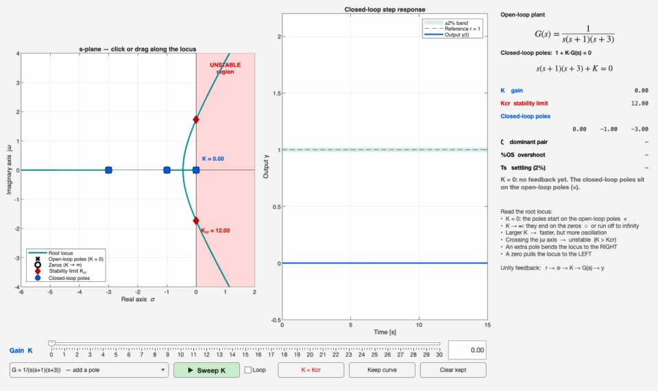
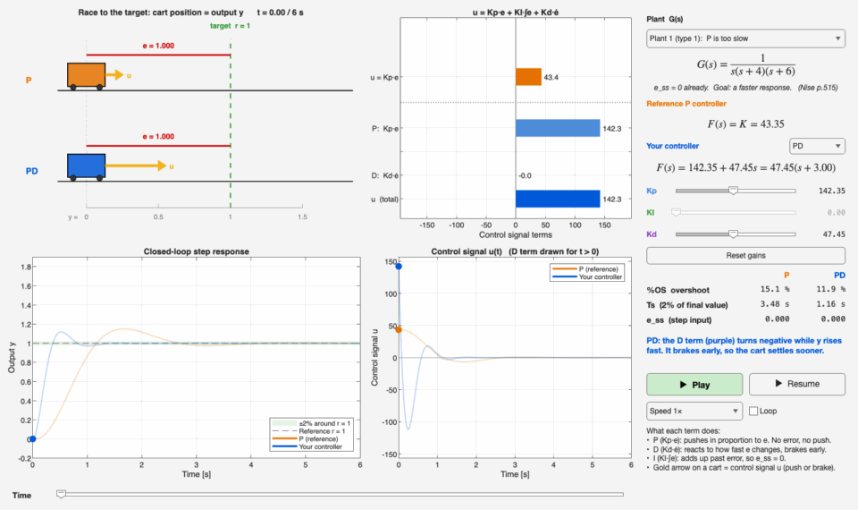
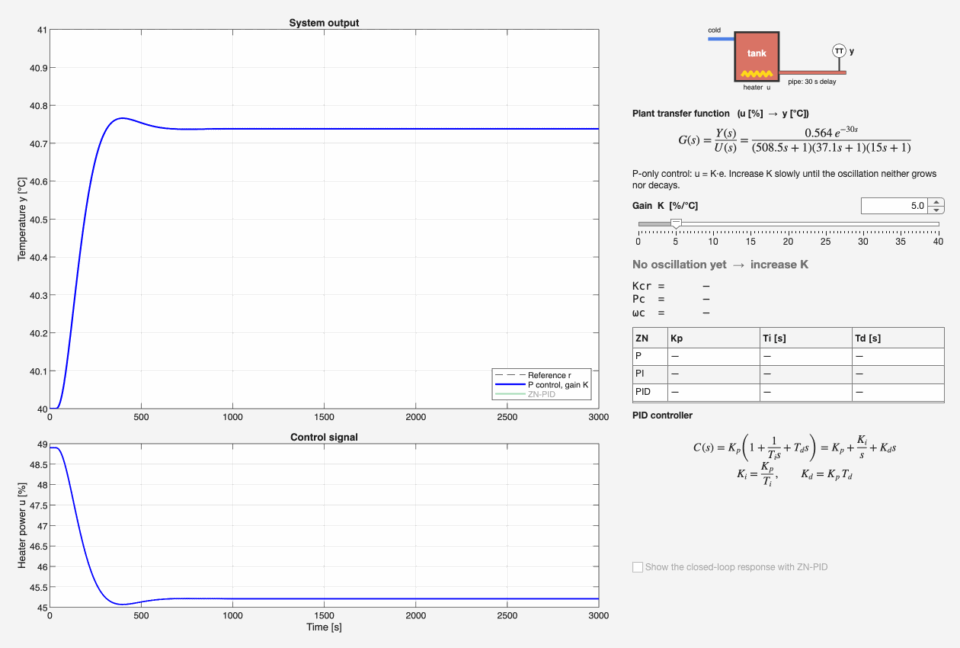

# KON314 – Control System Design

Interactive MATLAB labs for the KON314 Control System Design course. Each lab is a single `.m` file that students run from the MATLAB command window.

Requires MATLAB R2024b or newer. No toolboxes needed.

| Lab | Run | Topic |
|---|---|---|
| [Pole Drag Lab](#pole-drag-lab) | `PoleDragLab` | Pole location ↔ step response of a 2nd-order system |
| [Root Locus Lab](#root-locus-lab) | `RootLocusLab` | How the closed-loop poles move as the gain K grows |
| [PID Terms Lab](#pid-terms-lab) | `PIDTermsLab` | P vs. PD vs. PI vs. PID: what each controller term does |
| [Ziegler–Nichols Tuning Lab](#zieglernichols-tuning-lab) | `ZieglerNicholsLab` | Closed-loop (critical gain) PID tuning of a heated water tank |

---

## Pole Drag Lab

Where the poles are decides how the system moves. `PoleDragLab.m` links the pole locations of a 2nd-order system to its step response and to a moving mass–spring–damper.

$$G(s)=\frac{\omega_n^2}{s^2+2\zeta\omega_n s+\omega_n^2},\qquad p=\sigma\pm j\omega_d$$

```matlab
PoleDragLab
```



- Click or drag in the s-plane to move the pole pair. The mass goes back to rest and the expected response is shown faintly.
- **▶ Play** starts the mass–spring–damper ($m=1$, $c=2\zeta\omega_n$, $k=\omega_n^2$) from rest ($y=0$) and draws the step response as time runs. Use **Pause/Resume**, a speed of 0.25×–2×, and **Loop** to repeat.
- ζ, ωn, σ, ωd and the measured %OS, Tp, Ts and Tr update as the pole moves. The guide lines share colours with the readouts: vertical line ↔ Ts, horizontal line ↔ Tp, ray ↔ %OS (ζ), circle ↔ ωn.
- **Drag mode** keeps σ, ωd, ζ or ωn fixed while you drag, so students can see one specification stay fixed while the others change.
- **Examples:** ζ = 0.2, 0.7, 1, 0, and an unstable pole (the damper turns red: $c<0$).
- **Keep curve** freezes the current response in grey for comparison.

---

## Root Locus Lab

Turn up the gain and watch the poles move. `RootLocusLab.m` shows the closed-loop poles of a unity-feedback loop as the gain $K$ goes from 0 upward, next to the closed-loop step response.

$$1+K\,G(s)=0$$

```matlab
RootLocusLab
```



- Move the **K slider**, type a value, or click and drag along the locus in the s-plane.
- **▶ Sweep K** animates K from 0 to Kmax (tick **Loop** to repeat).
- The locus starts on the open-loop poles (×) and ends on the zeros (○) or goes to infinity.
- **Kcr** is the gain at which the poles cross the jω axis. **K = Kcr** jumps to it, and the response oscillates forever. This is the same Kcr as in the Ziegler–Nichols lab.
- **Examples:** $\frac{1}{s(s+1)}$ → add a pole $\frac{1}{s(s+1)(s+3)}$ (becomes unstable at $K_{cr}=12$) → add a zero $\frac{s+2}{s(s+1)}$, $\frac{s+2}{s(s+1)(s+3)}$ (stable for every K).
- **Keep curve** freezes the current response and poles in grey for comparison.

---

## PID Terms Lab

What does each term of the controller actually do? `PIDTermsLab.m` races two carts to the target $r=1$. A cart's position is the output $y$. The top cart uses a reference P controller, and the bottom cart uses your controller (P, PD, PI or PID). Bars show the terms of the control signal as time runs.

$$F(s)=K_p+\frac{K_I}{s}+K_d s,\qquad u=K_p\,e+K_I\!\int e\,dt+K_d\,\dot e$$

```matlab
PIDTermsLab
```



- **Plant 1, type 1: P is too slow** (Nise p.515): $G(s)=\frac{1}{s(s+4)(s+6)}$. P with $K=43.35$ gives 16 % overshoot. PD with $F(s)=47.45(s+3)$ keeps the overshoot and settles about 3× faster. The D term turns negative while $y$ rises fast, so it brakes early.
- **Plant 2, type 0: P leaves $e_{ss} \neq 0$** (Nise p.507): $G(s)=\frac{1}{(s+1)(s+2)(s+10)}$. P with $K=164.6$ ($\zeta=0.174$) stops short: $e_{ss}=0.108$. PI with $F(s)=158.2+\frac{15.82}{s}$ reaches $e_{ss}=0$. The I term keeps growing until $e=0$ and then holds $u$, while the P term goes to zero.
- The **u(t)** plot next to $y(t)$ shows the price of speed: PD starts with a much larger $u$ than P and goes negative to brake. With PI, $u$ stays at a constant value once $e=0$, which holds the type-0 plant at the target. The D term is drawn for $t>0$: the impulse an ideal PD gives at the step instant is left out.
- A gold arrow on each cart shows the control signal $u$: it pushes forward, or points backward when the controller brakes.
- The **Time** slider scrubs back and forth to any moment; **Resume** continues from there. Speeds run from 0.25× to 2×.
- **PID** combines both: on the PI example, adding $K_d$ removes the overshoot while $e_{ss}$ stays 0. Each term has its own bar.
- Change **Kp, KI, Kd** with the sliders or switch the controller type. **Reset gains** brings back the example's design.
- The table compares %OS, Ts (2 %) and $e_{ss}$ of both controllers.

---

## Ziegler–Nichols Tuning Lab

An interactive MATLAB app for teaching the **Ziegler–Nichols closed-loop (critical gain) method** on a real-world process: an electrically heated water tank whose temperature sensor sits at the end of an outlet pipe (≈ 30 s transport delay).

Students increase the proportional gain **K** step by step until the temperature oscillates with constant amplitude. The app then reports the critical gain **Kcr**, the period **Pc** and **ωc = 2π/Pc**, and gives the P / PI / PID gains from the Ziegler–Nichols table.

```matlab
ZieglerNicholsLab
```



### What students see

- A sketch of the process and its transfer function

  $$G(s)=\frac{Y(s)}{U(s)}=\frac{0.564\,e^{-30s}}{(508.5s+1)(37.1s+1)(15s+1)}$$

- Live plots of the output y(t) and the control signal u(t)
- A status message: *decaying → increase K*, *growing → decrease K*, *sustained → K = Kcr*
- Kcr, Pc, ωc and the Ziegler–Nichols table
- The PID controller in both forms, $C(s)=K_p\left(1+\frac{1}{T_i s}+T_d s\right)=K_p+\frac{K_i}{s}+K_d s$, with $K_i = K_p/T_i$ and $K_d = K_p T_d$
- The closed-loop response with the ZN-PID

---

## Files

| File | Description |
|---|---|
| `PoleDragLab.m` | Pole Drag Lab (single MATLAB file) |
| `ZieglerNicholsLab.m` | Ziegler–Nichols Tuning Lab (single MATLAB file) |
| `ZieglerNicholsLab_Guide.pdf` | Ziegler–Nichols student guide (2 pages) |
| `ZieglerNicholsLab_Guide.md` | Ziegler–Nichols student guide (Markdown) |
| `docs/` | Screenshots and animated GIFs used in this README |

## Acknowledgement

Developed with the assistance of [Claude Code](https://claude.com/claude-code) (Anthropic).

---
KON314 Control System Design
